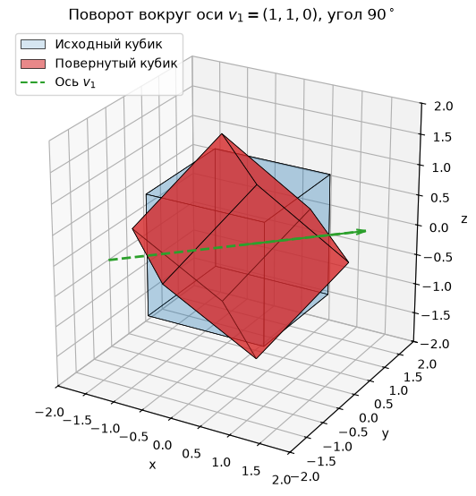
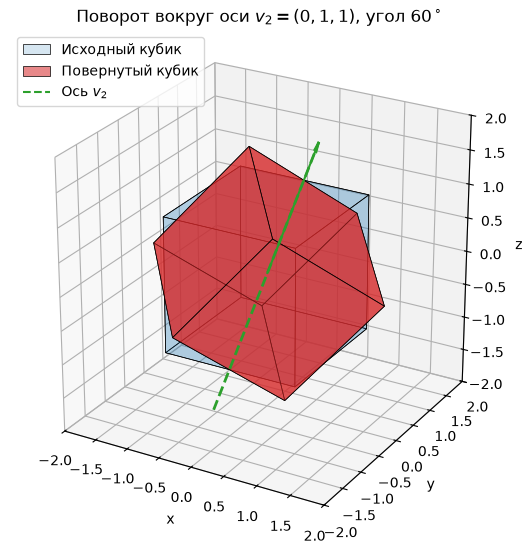
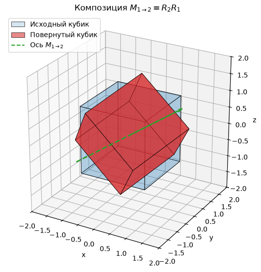
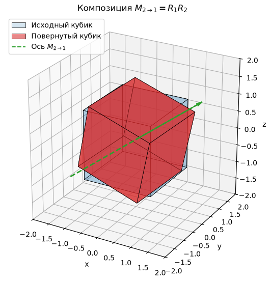
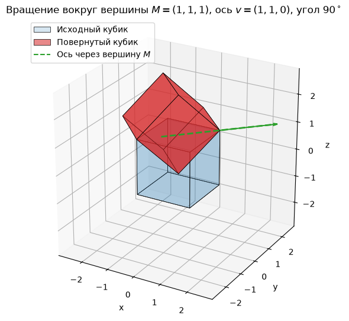

## Задание 4. Вращение кубика

**Постановка задачи**

Требуется повернуть кубик вокруг произвольной оси, проходящей через его центр. Ось вращения задается вектором

$$
v =
\begin{bmatrix}
v_x \\
v_y \\
v_z
\end{bmatrix},
$$

а угол поворота — величиной $\theta$. Матрица поворота определяется через матричную экспоненту:

$$
R_v(\theta) = e^{J\theta},
\qquad
J =
\frac{1}{\|v\|}
\begin{bmatrix}
0 & -v_z & v_y & 0 \\
v_z & 0 & -v_x & 0 \\
-v_y & v_x & 0 & 0 \\
0 & 0 & 0 & 0
\end{bmatrix}.
$$

Матрица $J$ имеет размер $4 \times 4$, поскольку вершины кубика заданы в однородных координатах. Последняя строка и последний столбец матрицы $J$ нулевые, поэтому в матричной экспоненте в правом нижнем углу стоит единица, а четвертая координата остается равной единице. Следовательно, преобразование является аффинным.

**Исходные данные**

Кубик задан в однородных координатах. Его вершины являются столбцами матрицы

$$
V =
\begin{bmatrix}
-1 & 1 & 1 & -1 & -1 & 1 & 1 & -1 \\
-1 & -1 & 1 & 1 & -1 & -1 & 1 & 1 \\
-1 & -1 & -1 & -1 & 1 & 1 & 1 & 1 \\
1 & 1 & 1 & 1 & 1 & 1 & 1 & 1
\end{bmatrix}.
$$

Центр кубика совпадает с началом координат, поэтому ось вращения, проходящая через центр кубика, проходит через точку $(0,0,0)$, и отдельная матрица переноса не требуется.

**Общая структура матрицы поворота**

Пусть

$$
u =
\frac{v}{\|v\|}
=
\begin{bmatrix}
u_x \\
u_y \\
u_z
\end{bmatrix},
\qquad
\|u\| = 1
$$

— нормированный вектор оси вращения. Кососимметрическая матрица, соответствующая этому вектору, имеет вид

$$
K =
\begin{bmatrix}
0 & -u_z & u_y & 0 \\
u_z & 0 & -u_x & 0 \\
-u_y & u_x & 0 & 0 \\
0 & 0 & 0 & 0
\end{bmatrix}.
$$

Для нормированного вектора $u$ выполняется свойство

$$
K^3 = -K.
$$

Поэтому матричная экспонента приводится к формуле Родригеса:

$$
R_u(\theta) = e^{K\theta}
=
I + \sin\theta \, K + (1-\cos\theta)K^2.
$$

В развернутом виде матрица поворота вокруг произвольной оси, проходящей через начало координат, имеет вид

$$
R_u(\theta) =
\begin{bmatrix}
\cos\theta + u_x^2(1-\cos\theta) &
u_xu_y(1-\cos\theta)-u_z\sin\theta &
u_xu_z(1-\cos\theta)+u_y\sin\theta &
0 \\
u_yu_x(1-\cos\theta)+u_z\sin\theta &
\cos\theta + u_y^2(1-\cos\theta) &
u_yu_z(1-\cos\theta)-u_x\sin\theta &
0 \\
u_zu_x(1-\cos\theta)-u_y\sin\theta &
u_zu_y(1-\cos\theta)+u_x\sin\theta &
\cos\theta + u_z^2(1-\cos\theta) &
0 \\
0 & 0 & 0 & 1
\end{bmatrix}.
$$

В программе матрица вычисляется напрямую по формуле $R_v(\theta)=e^{J\theta}$ с помощью `scipy.linalg.expm`; формула Родригеса приведена выше для аналитической записи этой же матрицы.

**Матрицы поворота вокруг координатных осей**

Частными случаями общей формулы являются повороты вокруг осей $x$, $y$ и $z$.

Поворот вокруг оси $x$:

$$
R_x(\theta) =
\begin{bmatrix}
1 & 0 & 0 & 0 \\
0 & \cos\theta & -\sin\theta & 0 \\
0 & \sin\theta & \cos\theta & 0 \\
0 & 0 & 0 & 1
\end{bmatrix}.
$$

Поворот вокруг оси $y$:

$$
R_y(\theta) =
\begin{bmatrix}
\cos\theta & 0 & \sin\theta & 0 \\
0 & 1 & 0 & 0 \\
-\sin\theta & 0 & \cos\theta & 0 \\
0 & 0 & 0 & 1
\end{bmatrix}.
$$

Поворот вокруг оси $z$:

$$
R_z(\theta) =
\begin{bmatrix}
\cos\theta & -\sin\theta & 0 & 0 \\
\sin\theta & \cos\theta & 0 & 0 \\
0 & 0 & 1 & 0 \\
0 & 0 & 0 & 1
\end{bmatrix}.
$$

Эти матрицы получаются из общей формулы при выборе единичных векторов

$$
e_x =
\begin{bmatrix}
1 \\
0 \\
0
\end{bmatrix},
\qquad
e_y =
\begin{bmatrix}
0 \\
1 \\
0
\end{bmatrix},
\qquad
e_z =
\begin{bmatrix}
0 \\
0 \\
1
\end{bmatrix}.
$$

**Выбранные оси и углы поворота**

Для выполнения задания выбраны две произвольные оси вращения и два угла поворота.

Первая ось:

$$
v_1 =
\begin{bmatrix}
1 \\
1 \\
0
\end{bmatrix},
\qquad
\theta_1 = \frac{\pi}{2},
\qquad
u_1 =
\frac{v_1}{\|v_1\|}
=
\begin{bmatrix}
\frac{1}{\sqrt{2}} \\
\frac{1}{\sqrt{2}} \\
0
\end{bmatrix}.
$$

Ось $v_1$ проходит через центр кубика и направлена вдоль диагонали плоскости $xy$.

Вторая ось:

$$
v_2 =
\begin{bmatrix}
0 \\
1 \\
1
\end{bmatrix},
\qquad
\theta_2 = \frac{\pi}{3},
\qquad
u_2 =
\frac{v_2}{\|v_2\|}
=
\begin{bmatrix}
0 \\
\frac{1}{\sqrt{2}} \\
\frac{1}{\sqrt{2}}
\end{bmatrix}.
$$

Ось $v_2$ проходит через центр кубика и направлена вдоль диагонали плоскости $yz$.

**Матрица первого поворота**

Для оси $v_1$ и угла $\theta_1=\frac{\pi}{2}$ имеем

$$
\sin\frac{\pi}{2} = 1,
\qquad
\cos\frac{\pi}{2} = 0.
$$

Подстановка в общую формулу дает

$$
R_1 =
\begin{bmatrix}
\frac{1}{2} & \frac{1}{2} & \frac{1}{\sqrt{2}} & 0 \\
\frac{1}{2} & \frac{1}{2} & -\frac{1}{\sqrt{2}} & 0 \\
-\frac{1}{\sqrt{2}} & \frac{1}{\sqrt{2}} & 0 & 0 \\
0 & 0 & 0 & 1
\end{bmatrix}
\approx
\begin{bmatrix}
0.500000 & 0.500000 & 0.707107 & 0 \\
0.500000 & 0.500000 & -0.707107 & 0 \\
-0.707107 & 0.707107 & 0.000000 & 0 \\
0 & 0 & 0 & 1
\end{bmatrix}.
$$

Эта матрица выполняет поворот кубика на $90^\circ$ вокруг оси, направленной вдоль вектора $v_1$.

Проверим, что точка на оси вращения остается неподвижной. Возьмем точку

$$
p =
\begin{bmatrix}
1 \\
1 \\
0 \\
1
\end{bmatrix}.
$$

Тогда

$$
R_1 p =
\begin{bmatrix}
1 \\
1 \\
0 \\
1
\end{bmatrix}
= p.
$$

Следовательно, прямая, проходящая через начало координат вдоль вектора $v_1$, действительно является осью вращения.

**Матрица второго поворота**

Для оси $v_2$ и угла $\theta_2=\frac{\pi}{3}$ имеем

$$
\sin\frac{\pi}{3} = \frac{\sqrt{3}}{2},
\qquad
\cos\frac{\pi}{3} = \frac{1}{2}.
$$

После подстановки в общую формулу получаем

$$
R_2 =
\begin{bmatrix}
\frac{1}{2} & -\frac{\sqrt{6}}{4} & \frac{\sqrt{6}}{4} & 0 \\
\frac{\sqrt{6}}{4} & \frac{3}{4} & \frac{1}{4} & 0 \\
-\frac{\sqrt{6}}{4} & \frac{1}{4} & \frac{3}{4} & 0 \\
0 & 0 & 0 & 1
\end{bmatrix}
\approx
\begin{bmatrix}
0.500000 & -0.612372 & 0.612372 & 0 \\
0.612372 & 0.750000 & 0.250000 & 0 \\
-0.612372 & 0.250000 & 0.750000 & 0 \\
0 & 0 & 0 & 1
\end{bmatrix}.
$$

Эта матрица выполняет поворот кубика на $60^\circ$ вокруг оси, направленной вдоль вектора $v_2$.

Проверка неподвижности оси:

$$
p =
\begin{bmatrix}
0 \\
1 \\
1 \\
1
\end{bmatrix},
\qquad
R_2 p =
\begin{bmatrix}
0 \\
1 \\
1 \\
1
\end{bmatrix}
= p.
$$

Следовательно, ось вращения задана корректно.

**Композиция двух поворотов**

Поскольку вершины кубика рассматриваются как столбцы матрицы $V$, преобразование применяется умножением матрицы слева:

$$
V' = R V.
$$

Если сначала выполняется поворот $R_1$, а затем $R_2$, итоговая матрица имеет вид

$$
M_{1 \to 2} = R_2 R_1.
$$

Если сначала выполняется поворот $R_2$, а затем $R_1$, итоговая матрица имеет вид

$$
M_{2 \to 1} = R_1 R_2.
$$

В общем случае повороты в трехмерном пространстве не коммутируют, поэтому $R_2R_1 \neq R_1R_2$.

**Композиция $M_{1 \to 2} = R_2R_1$**

Сначала выполняется поворот вокруг оси $v_1$ на угол $\theta_1=\frac{\pi}{2}$, затем — поворот вокруг оси $v_2$ на угол $\theta_2=\frac{\pi}{3}$. Численно:

$$
M_{1 \to 2} \approx
\begin{bmatrix}
-0.489199 & 0.376827 & 0.786566 & 0 \\
0.504410 & 0.857963 & -0.097317 & 0 \\
-0.711516 & 0.349144 & -0.609789 & 0 \\
0 & 0 & 0 & 1
\end{bmatrix}.
$$

Результирующее преобразование также является поворотом вокруг некоторой оси. Нормированный вектор эквивалентной оси вращения приближенно равен

$$
u_{1 \to 2} \approx
\begin{bmatrix}
0.2847 \\
0.9552 \\
0.0814
\end{bmatrix}.
$$

**Композиция $M_{2 \to 1} = R_1R_2$**

Сначала выполняется поворот вокруг оси $v_2$ на угол $\theta_2=\frac{\pi}{3}$, затем — поворот вокруг оси $v_1$ на угол $\theta_1=\frac{\pi}{2}$. Численно:

$$
M_{2 \to 1} \approx
\begin{bmatrix}
0.123174 & 0.245590 & 0.961516 & 0 \\
0.989199 & -0.107963 & -0.099144 & 0 \\
0.079459 & 0.963343 & -0.256236 & 0 \\
0 & 0 & 0 & 1
\end{bmatrix}.
$$

Нормированный вектор эквивалентной оси вращения приближенно равен

$$
u_{2 \to 1} \approx
\begin{bmatrix}
0.6774 \\
0.5624 \\
0.4741
\end{bmatrix}.
$$

**Демонстрация некоммутативности поворотов**

Сравним полученные матрицы:

$$
M_{1 \to 2} = R_2R_1,
\qquad
M_{2 \to 1} = R_1R_2.
$$

Видно, что $M_{1 \to 2} \neq M_{2 \to 1}$. Например, элемент в первой строке и первом столбце:

$$
(M_{1 \to 2})_{11} \approx -0.489199,
\qquad
(M_{2 \to 1})_{11} \approx 0.123174.
$$

Следовательно, порядок применения поворотов существенно влияет на итоговое положение кубика: последовательные повороты вокруг различных осей в трехмерном пространстве не коммутируют.

**Результаты выполнения программы**

На каждом графике показаны исходный кубик (синий, полупрозрачный), кубик после применения соответствующей матрицы (красный), пунктирная ось вращения и вектор, коллинеарный этой оси. Для композиций на графиках показана эквивалентная ось результирующего поворота.

После применения любой из матриц четвертая однородная координата остается равной единице, поэтому в таблицах приведены только декартовы координаты $x$, $y$ и $z$.

**Поворот вокруг оси $v_1$**

Применяется матрица $R_1$. Ось вращения — $v_1=(1,1,0)^T$, угол поворота — $\theta_1=\frac{\pi}{2}$. Ожидаемый результат: кубик повернут на $90^\circ$ вокруг диагонали плоскости $xy$.

Результат показан на рисунке, координаты вершин приведены в таблице 4.1.

**Таблица — Координаты вершин после применения $R_1$**

| № вершины | $x$ | $y$ | $z$ |
|---:|---:|---:|---:|
| 1 | -1.707 | -0.293 | 0.000 |
| 2 | -0.707 | 0.707 | -1.414 |
| 3 | 0.293 | 1.707 | 0.000 |
| 4 | -0.707 | 0.707 | 1.414 |
| 5 | -0.293 | -1.707 | 0.000 |
| 6 | 0.707 | -0.707 | -1.414 |
| 7 | 1.707 | 0.293 | 0.000 |
| 8 | 0.707 | -0.707 | 1.414 |

**Поворот вокруг оси $v_2$**

Применяется матрица $R_2$. Ось вращения — $v_2=(0,1,1)^T$, угол поворота — $\theta_2=\frac{\pi}{3}$. Ожидаемый результат: кубик повернут на $60^\circ$ вокруг диагонали плоскости $yz$.

Результат показан на рисунке, координаты вершин приведены в таблице 4.2.

**Таблица — Координаты вершин после применения $R_2$**

| № вершины | $x$ | $y$ | $z$ |
|---:|---:|---:|---:|
| 1 | -0.500 | -1.612 | -0.388 |
| 2 | 0.500 | -0.388 | -1.612 |
| 3 | -0.725 | 1.112 | -1.112 |
| 4 | -1.725 | -0.112 | 0.112 |
| 5 | 0.725 | -1.112 | 1.112 |
| 6 | 1.725 | 0.112 | -0.112 |
| 7 | 0.500 | 1.612 | 0.388 |
| 8 | -0.500 | 0.388 | 1.612 |

**Композиция $M_{1 \to 2}=R_2R_1$**

Порядок преобразований: сначала поворот вокруг оси $v_1$, затем поворот вокруг оси $v_2$. Эквивалентная ось вращения — $u_{1 \to 2}\approx(0.2847,\;0.9552,\;0.0814)^T$.

Результат показан на рисунке, координаты вершин приведены в таблице 4.3.

**Таблица — Координаты вершин после применения $M_{1 \to 2}=R_2R_1$**

| № вершины | $x$ | $y$ | $z$ |
|---:|---:|---:|---:|
| 1 | -0.674 | -1.265 | 0.972 |
| 2 | -1.653 | -0.256 | -0.451 |
| 3 | -0.899 | 1.460 | 0.247 |
| 4 | 0.079 | 0.451 | 1.670 |
| 5 | 0.899 | -1.460 | -0.247 |
| 6 | -0.079 | -0.451 | -1.670 |
| 7 | 0.674 | 1.265 | -0.972 |
| 8 | 1.653 | 0.256 | 0.451 |

**Композиция $M_{2 \to 1}=R_1R_2$**

Порядок преобразований: сначала поворот вокруг оси $v_2$, затем поворот вокруг оси $v_1$. Эквивалентная ось вращения — $u_{2 \to 1}\approx(0.6774,\;0.5624,\;0.4741)^T$.

Результат показан на рисунке, координаты вершин приведены в таблице 4.4.

**Таблица — Координаты вершин после применения $M_{2 \to 1}=R_1R_2$**

| № вершины | $x$ | $y$ | $z$ |
|---:|---:|---:|---:|
| 1 | -1.330 | -0.782 | -0.787 |
| 2 | -1.084 | 1.196 | -0.628 |
| 3 | -0.593 | 0.980 | 1.299 |
| 4 | -0.839 | -0.998 | 1.140 |
| 5 | 0.593 | -0.980 | -1.299 |
| 6 | 0.839 | 0.998 | -1.140 |
| 7 | 1.330 | 0.782 | 0.787 |
| 8 | 1.084 | -1.196 | 0.628 |

**Анализ полученных результатов**

**Влияние оси вращения.** Ось вращения определяет неподвижную прямую в пространстве: все точки, лежащие на ней, остаются на месте. Для оси $v_1$ это прямая

$$
(0,0,0) + t(1,1,0),
$$

а для оси $v_2$ — прямая

$$
(0,0,0) + t(0,1,1).
$$

Ось $v_1$ проходит через середины двух противоположных вертикальных ребер кубика, а ось $v_2$ — через середины двух противоположных ребер, параллельных оси $x$. Ни одна вершина кубика на этих осях не лежит, поэтому при выбранных углах вершины не остаются неподвижными.

**Влияние угла поворота.** Угол $\theta$ задает величину поворота вокруг выбранной оси:

- при $\theta=0$ кубик остается неподвижным;
- при $\theta=\frac{\pi}{2}$ выполняется поворот на $90^\circ$;
- при $\theta=\pi$ — поворот на $180^\circ$;
- при $\theta=2\pi$ кубик возвращается в исходное положение.

При выбранных углах $90^\circ$ и $60^\circ$ кубик не переходит в себя, а занимает новое положение. При этом преобразование является движением: расстояния между вершинами сохраняются. Например, расстояние между вершинами 1 и 2 после применения $R_1$ остается равным 2.

**Влияние порядка преобразований.** Матрицы $M_{1 \to 2}=R_2R_1$ и $M_{2 \to 1}=R_1R_2$ различны, поэтому итоговая ориентация кубика зависит от порядка поворотов. При этом

$$
M_{2 \to 1} = R_1M_{1 \to 2}R_1^{-1},
$$

то есть матрицы подобны. Угол поворота определяется следом матрицы:

$$
\theta = \arccos\left(\frac{\operatorname{tr}R - 1}{2}\right).
$$

Для обеих матриц $\operatorname{tr}R \approx -0.241025$. Поскольку следы подобных матриц совпадают, у обеих композиций одинаковый угол поворота $128.35^\circ$, но эквивалентные оси различны:

$$
u_{1 \to 2} \approx
\begin{bmatrix}
0.2847 \\
0.9552 \\
0.0814
\end{bmatrix},
\qquad
u_{2 \to 1} \approx
\begin{bmatrix}
0.6774 \\
0.5624 \\
0.4741
\end{bmatrix}.
$$

Таким образом, при одном и том же суммарном угле поворота кубик оказывается в разных положениях.

**Проверка корректности матриц поворота.** Для всех четырех матриц верхний блок $3 \times 3$ ортогонален:

$$
R^T R = I,
$$

а его определитель равен единице:

$$
\det R = 1.
$$

Это означает, что преобразования сохраняют длины, углы, объемы и ориентацию пространства. Кроме того, для осей выполняются равенства

$$
R_1
\begin{bmatrix}
1 \\
1 \\
0 \\
0
\end{bmatrix}
=
\begin{bmatrix}
1 \\
1 \\
0 \\
0
\end{bmatrix},
\qquad
R_2
\begin{bmatrix}
0 \\
1 \\
1 \\
0
\end{bmatrix}
=
\begin{bmatrix}
0 \\
1 \\
1 \\
0
\end{bmatrix}.
$$

Здесь направления осей записаны в однородных координатах с нулевой четвертой компонентой. Следовательно, векторы $v_1$ и $v_2$ действительно являются собственными векторами соответствующих матриц с собственным числом 1, то есть задают оси вращения.

**Восстановление оси вращения по матрице поворота**

Для композиции поворотов эквивалентную ось можно восстановить непосредственно из матрицы. Если

$$
R =
\begin{bmatrix}
r_{11} & r_{12} & r_{13} \\
r_{21} & r_{22} & r_{23} \\
r_{31} & r_{32} & r_{33}
\end{bmatrix},
$$

то вектор оси вращения пропорционален вектору

$$
u \sim
\begin{bmatrix}
r_{32} - r_{23} \\
r_{13} - r_{31} \\
r_{21} - r_{12}
\end{bmatrix}.
$$

После нормировки

$$
u = \frac{u}{\|u\|}.
$$

Именно так в программе получены оси $u_{1 \to 2}$ и $u_{2 \to 1}$. Формула применима при $\sin\theta \neq 0$; для углов $0$ и $\pi$ вектор оси находится через собственный вектор матрицы $R$ с собственным числом 1.

**Вывод**

В задании построена матрица поворота вокруг произвольной оси, проходящей через центр кубика. Матричная экспонента $e^{J\theta}$ сведена к формуле Родригеса, а для осей $x$, $y$ и $z$ получены частные случаи $R_x$, $R_y$, $R_z$.

Для двух выбранных осей и углов построены матрицы $R_1$ и $R_2$, а также две их композиции — $R_2R_1$ и $R_1R_2$. Расчеты и результаты программы показывают, что матрицы композиций различны: при одинаковом угле $128.35^\circ$ оси вращения не совпадают. Следовательно, порядок применения поворотов влияет на итоговую ориентацию кубика.

Корректность матриц подтверждена проверками: $R^TR=I$, $\det R=1$, а векторы $v_1$ и $v_2$ остаются неподвижными. На всех графиках дополнительно показан вектор, коллинеарный оси вращения.

## Задание 5. Вращение кубика вокруг вершины

**Общая формула поворота вокруг оси, проходящей через точку**

Пусть ось вращения проходит через точку

$$
M =
\begin{bmatrix}
x_0 \\
y_0 \\
z_0
\end{bmatrix}
$$

и имеет направление $v$, а угол поворота равен $\theta$. Чтобы свести такое вращение к уже известному повороту вокруг начала координат, выполним три аффинных преобразования.

1. Перенесем объект так, чтобы точка $M$ совпала с началом координат:

$$
T(-M) =
\begin{bmatrix}
1 & 0 & 0 & -x_0 \\
0 & 1 & 0 & -y_0 \\
0 & 0 & 1 & -z_0 \\
0 & 0 & 0 & 1
\end{bmatrix}.
$$

2. Повернем объект вокруг начала координат вокруг оси с направлением $v$ на угол $\theta$:

$$
R_v(\theta).
$$

3. Вернем точку $M$ на место обратным переносом:

$$
T(M) =
\begin{bmatrix}
1 & 0 & 0 & x_0 \\
0 & 1 & 0 & y_0 \\
0 & 0 & 1 & z_0 \\
0 & 0 & 0 & 1
\end{bmatrix}.
$$

Итоговая матрица преобразования имеет вид

$$
M_{\text{pivot}} = T(M)\,R_v(\theta)\,T(-M).
$$

Обозначим через $R$ верхний левый блок $3 \times 3$ матрицы $R_v(\theta)$. Тогда

$$
M_{\text{pivot}} =
\begin{bmatrix}
R & M - RM \\
\mathbf{0}_{1 \times 3} & 1
\end{bmatrix}.
$$

Действительно,

$$
T(M)
\begin{bmatrix}
R & 0 \\
\mathbf{0}_{1 \times 3} & 1
\end{bmatrix}
T(-M)
=
\begin{bmatrix}
R & M - RM \\
\mathbf{0}_{1 \times 3} & 1
\end{bmatrix}.
$$

Вектор $M - RM$ — это сдвиг, который компенсирует поворот точки $M$ вокруг начала координат. Поэтому

$$
M_{\text{pivot}}
\begin{bmatrix}
M \\
1
\end{bmatrix}
=
\begin{bmatrix}
M \\
1
\end{bmatrix},
$$

то есть выбранная точка оси остается неподвижной. Матрица $R$ — это матрица поворота вокруг начала координат, построенная в задании 4.

**Выбранная матрица преобразования**

Выберем вершину кубика

$$
M =
\begin{bmatrix}
1 \\
1 \\
1
\end{bmatrix}.
$$

В однородных координатах:

$$
M =
\begin{bmatrix}
1 \\
1 \\
1 \\
1
\end{bmatrix}.
$$

Ось вращения зададим направлением

$$
v =
\begin{bmatrix}
1 \\
1 \\
0
\end{bmatrix},
\qquad
\theta = \frac{\pi}{2},
\qquad
u =
\frac{v}{\|v\|}
=
\begin{bmatrix}
\frac{1}{\sqrt{2}} \\
\frac{1}{\sqrt{2}} \\
0
\end{bmatrix}.
$$

Ось проходит через вершину $M$ и описывается уравнением

$$
L(t) = M + tu
=
\begin{bmatrix}
1 \\
1 \\
1
\end{bmatrix}
+
t
\begin{bmatrix}
\frac{1}{\sqrt{2}} \\
\frac{1}{\sqrt{2}} \\
0
\end{bmatrix}.
$$

Матрица поворота вокруг этой оси на угол $\theta=\frac{\pi}{2}$:

$$
R_v\left(\frac{\pi}{2}\right) =
\begin{bmatrix}
\frac{1}{2} & \frac{1}{2} & \frac{1}{\sqrt{2}} & 0 \\
\frac{1}{2} & \frac{1}{2} & -\frac{1}{\sqrt{2}} & 0 \\
-\frac{1}{\sqrt{2}} & \frac{1}{\sqrt{2}} & 0 & 0 \\
0 & 0 & 0 & 1
\end{bmatrix}.
$$

Матрицы переносов:

$$
T(-M) =
\begin{bmatrix}
1 & 0 & 0 & -1 \\
0 & 1 & 0 & -1 \\
0 & 0 & 1 & -1 \\
0 & 0 & 0 & 1
\end{bmatrix},
\qquad
T(M) =
\begin{bmatrix}
1 & 0 & 0 & 1 \\
0 & 1 & 0 & 1 \\
0 & 0 & 1 & 1 \\
0 & 0 & 0 & 1
\end{bmatrix}.
$$

После перемножения получаем

$$
M_{\text{pivot}} = T(M)\,R_v\left(\frac{\pi}{2}\right)\,T(-M)
=
\begin{bmatrix}
\frac{1}{2} & \frac{1}{2} & \frac{1}{\sqrt{2}} & -\frac{1}{\sqrt{2}} \\
\frac{1}{2} & \frac{1}{2} & -\frac{1}{\sqrt{2}} & \frac{1}{\sqrt{2}} \\
-\frac{1}{\sqrt{2}} & \frac{1}{\sqrt{2}} & 0 & 1 \\
0 & 0 & 0 & 1
\end{bmatrix}
\approx
\begin{bmatrix}
0.500000 & 0.500000 & 0.707107 & -0.707107 \\
0.500000 & 0.500000 & -0.707107 & 0.707107 \\
-0.707107 & 0.707107 & 0.000000 & 1.000000 \\
0 & 0 & 0 & 1
\end{bmatrix}.
$$

Проверим неподвижность выбранной вершины:

$$
M_{\text{pivot}}
\begin{bmatrix}
1 \\
1 \\
1 \\
1
\end{bmatrix}
=
\begin{bmatrix}
1 \\
1 \\
1 \\
1
\end{bmatrix}.
$$

Следовательно, вершина $M=(1,1,1)$ остается на месте. На той же прямой лежит вершина $(-1,-1,1)$, поэтому она также неподвижна.

**Результаты выполнения программы**

На рисунке показаны исходный кубик (синий, полупрозрачный), кубик после применения $M_{\text{pivot}}$ (красный) и ось вращения, проходящая через вершину $M=(1,1,1)$.

**Таблица — Координаты вершин после применения $M_{\text{pivot}}$**

| № вершины | $x$ | $y$ | $z$ |
|---:|---:|---:|---:|
| 1 | -2.414 | 0.414 | 1.000 |
| 2 | -1.414 | 1.414 | -0.414 |
| 3 | -0.414 | 2.414 | 1.000 |
| 4 | -1.414 | 1.414 | 2.414 |
| 5 | -1.000 | -1.000 | 1.000 |
| 6 | 0.000 | 0.000 | -0.414 |
| 7 | 1.000 | 1.000 | 1.000 |
| 8 | 0.000 | 0.000 | 2.414 |

Верхний блок матрицы ортогонален: $R^TR=I$, а его определитель равен единице: $\det R=1$. Четвертая однородная координата всех вершин остается равной единице, поэтому преобразование является аффинным. Вершины 5 и 7 не меняют положения, поскольку лежат на оси вращения.

**Вывод**

Получена общая формула матрицы поворота вокруг оси с направлением $v$, проходящей через точку $M(x_0,y_0,z_0)$:

$$
M_{\text{pivot}} = T(M)\,R_v(\theta)\,T(-M).
$$

Для вершины $M=(1,1,1)$, оси $v=(1,1,0)$ и угла $\theta=\frac{\pi}{2}$ построена конкретная матрица $M_{\text{pivot}}$. Она переводит кубик в новое положение, оставляя выбранную вершину неподвижной. Результат подтвержден графиком и координатами вершин: преобразование является движением, а ось вращения проходит через вершину кубика.
