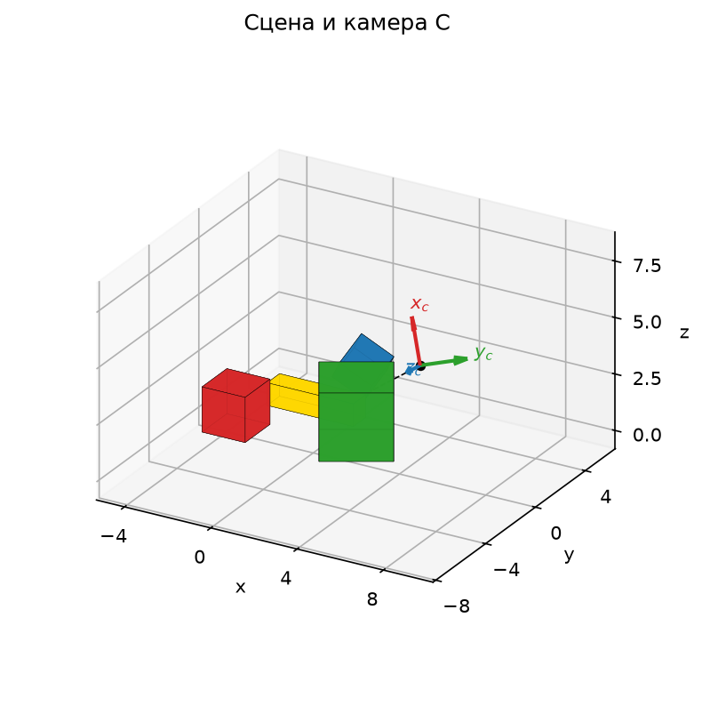
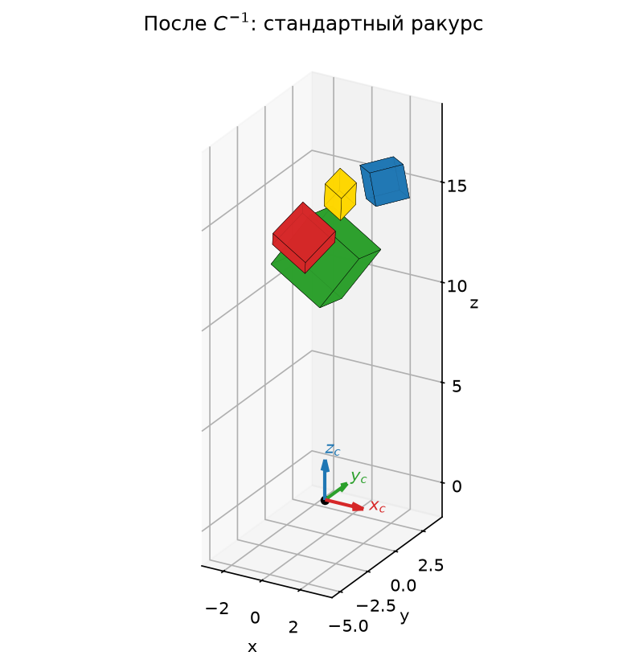

## Задание 6. Реализация камеры

### Сцена из нескольких кубиков

Сцена собрана из четырёх копий исходного куба $V$ с ребром $2$.
Каждая копия получает свою модельную матрицу $M_i$, составленную
из матриц прошлых заданий в порядке «масштаб, поворот, перенос»:
$M=T\,R\,S$, то есть правая матрица применяется первой.

- Красный: $M_{\text{red}}=T(-3,-1,1)$ — куб стоит на плоскости $z=0$.
- Зелёный: $M_{\text{green}}=T(2,0,1.5)\,R_z(30^\circ)\,S(1.5,1.5,1.5)$.
- Синий: $M_{\text{blue}}=T(0,4,1.4)\,R_v(45^\circ)\,S(0.8,0.8,0.8)$, $v=(1,1,0)$.
- Жёлтый брусок: $M_{\text{yellow}}=T(-1,2,0.5)\,S(2,0.5,0.5)$.

Повороты вычислены как $e^{J\theta}$ функцией `scipy.linalg.expm`, как в задании 4.
На рисунке p6_views сцена показана в стандартном ракурсе и снизу,
командой `ax.view_init(azim=0, elev=-90)`. Во втором случае
наблюдатель смотрит вдоль $+z$: ось $x$ направлена вверх по экрану, ось $y$ — вправо.

Все рисунки построены с `proj_type="ortho"`. Matplotlib не добавляет
собственную перспективу, поэтому всё искажение пространства в задании 7
создаёт только матрица $P$.

### Матрица камеры

Стандартная камера стоит в начале координат и смотрит вдоль оси $+z$.
Ось $x_c$ камеры направлена вверх по кадру, ось $y_c$ — вправо.
При $x_c\times y_c=z_c$ это правая тройка. Такой выбор совпадает с видом
`view_init(azim=0, elev=-90)`, поэтому кадр камеры можно сразу показать этой командой.

Положение камеры задаётся двумя матрицами: поворотом $R_c$ и переносом $T_c$.
Матрица $C$ переводит координаты, записанные относительно камеры, в мировые:

$$
C=T_c\,R_c=
\begin{pmatrix}
\mathbf u & \mathbf r & \mathbf f & \mathbf c\\
0&0&0&1
\end{pmatrix},
$$

где $\mathbf c$ — положение камеры, а столбцы $\mathbf u,\mathbf r,\mathbf f$ —
мировые направления её осей «вверх», «вправо» и «вперёд».
Камера поставлена в $\mathbf c=(9,-7,8)$ и направлена на точку
$\mathbf a=(0,1,0.5)$ в середине сцены — с отдаления и под углом сверху.
Базис камеры строится так:

$$
\mathbf f=\frac{\mathbf a-\mathbf c}{\|\mathbf a-\mathbf c\|},\qquad
\mathbf r=\frac{\mathbf f\times\mathbf e_z}{\|\mathbf f\times\mathbf e_z\|},\qquad
\mathbf u=\mathbf r\times\mathbf f.
$$

Получились матрицы

$$
T_c=\begin{pmatrix}
1&0&0&9\\0&1&0&-7\\0&0&1&8\\0&0&0&1
\end{pmatrix},\qquad
R_c\approx\begin{pmatrix}
-0.395&0.664&-0.634&0\\
0.351&0.747&0.564&0\\
0.849&0&-0.529&0\\
0&0&0&1
\end{pmatrix}.
$$

Столбцы $R_c$ ортонормированы, $\det R_c=1$, поэтому $R_c\in SO(3)$.
Это действительно поворот $R_c(\theta)$: по следу и кососимметрической части
(как в задании 4) находим ось $(-0.349,-0.917,-0.194)$ и угол $\theta\approx126.03^\circ$.
Матрица $e^{J\theta}$ для этой оси совпадает с $R_c$.

$$
C=T_cR_c\approx\begin{pmatrix}
-0.395&0.664&-0.634&9\\
0.351&0.747&0.564&-7\\
0.849&0&-0.529&8\\
0&0&0&1
\end{pmatrix}.
$$

Положение камеры, её оси и направление взгляда (пунктир к точке $\mathbf a$)
показаны на рисунке p6_camera.

### Обратная матрица камеры

Чтобы увидеть сцену глазами камеры, нужно переместить камеру в начало координат
со стандартным поворотом. Значит, ко всем объектам применяется $C^{-1}$.
Обратная к произведению берётся в обратном порядке; для поворота $R_c^{-1}=R_c^T$,
для переноса $T_c^{-1}=T(-\mathbf c)$:

$$
C^{-1}=R_c^{-1}T_c^{-1}=R_c^T\,T(-\mathbf c)=
\begin{pmatrix}
R_c^T & -R_c^T\mathbf c\\
\mathbf 0 & 1
\end{pmatrix}
\approx\begin{pmatrix}
-0.395&0.351&0.849&-0.776\\
0.664&0.747&0&-0.747\\
-0.634&0.564&-0.529&13.887\\
0&0&0&1
\end{pmatrix}.
$$

Сначала $T(-\mathbf c)$ сдвигает всю сцену так, что камера оказывается в нуле.
Затем $R_c^T$ поворачивает пространство, совмещая оси камеры с осями $x,y,z$.
Программа проверяет: $CC^{-1}=I$, $C^{-1}(\mathbf c,1)^T=(0,0,0,1)^T$,
а точка $\mathbf a$ переходит в $(0,0,14.186)$ — на ось взгляда $+z$
на расстояние $\|\mathbf a-\mathbf c\|$.
После преобразования все вершины сцены имеют $z$ от $9.42$ до $17.20$, то есть лежат перед камерой.

Результат применения $C^{-1}$ показан на рисунке p6_inv. В стандартном ракурсе
видно, что сцена «повисла» над камерой вдоль оси $z$. Вид снизу — это
ортографический кадр самой камеры: красный куб слева, синий справа,
ближний к камере зелёный частично закрывает жёлтый брусок.

### Вывод по заданию 6

Сцена из четырёх кубиков построена модельными матрицами $TRS$ из заданий 2–5.
Камера задана поворотом $R_c$ — это поворот на $126.03^\circ$ вокруг оси
$(-0.349,-0.917,-0.194)$ — и переносом $T_c$.
Обратная матрица $C^{-1}=R_c^TT(-\mathbf c)$ не меняет форму объектов:
это движение. Она лишь записывает всю сцену в системе координат камеры.
Поэтому «подвинуть камеру» и «подвинуть мир обратным преобразованием» — одно и то же.

## Задание 7. Реализация перспективы

### Общая форма матрицы перспективы

Камера смотрит вдоль $+z$. Видимая область — усечённая пирамида между
ближней плоскостью $z=n$ и дальней $z=f$. На ближней плоскости
она ограничена прямоугольником $l\le x\le r$, $b\le y\le t$. Матрица перспективы

$$
P=\begin{pmatrix}
\dfrac{2n}{r-l}&0&-\dfrac{r+l}{r-l}&0\\[8pt]
0&\dfrac{2n}{t-b}&-\dfrac{t+b}{t-b}&0\\[8pt]
0&0&\dfrac{f+n}{f-n}&-\dfrac{2fn}{f-n}\\[8pt]
0&0&1&0
\end{pmatrix}
$$

переводит эту пирамиду в куб $[-1,1]^3$. Главное — последняя строка:
после умножения четвёртая координата становится $w'=z$, то есть глубиной точки.
Деление на $w'$ при переходе к декартовым координатам и даёт перспективу:

$$
x'=\frac{2n}{r-l}\cdot\frac{x}{z}-\frac{r+l}{r-l},\qquad
z'=\frac{f+n}{f-n}-\frac{2fn}{(f-n)\,z}.
$$

Дальние точки ($z$ больше) сильнее прижимаются к центру кадра,
поэтому дальние предметы выглядят меньше. Подстановка проверяет границы:
$x=l\,z/n\mapsto x'=-1$, $x=r\,z/n\mapsto x'=1$,
$z=n\mapsto z'=-1$, $z=f\mapsto z'=1$. Матрица $P$ невырожденная, но не аффинная:
её последняя строка не равна $(0,0,0,1)$. Поэтому прямые переходят в прямые,
а параллельность и отношения длин не сохраняются.

По сравнению с источником, где камера смотрит вдоль $-z$, здесь иные знаки
третьего столбца: выбран взгляд вдоль $+z$, совпадающий с видом `elev=-90`.

Для реализации нужно выбрать:

- расстояния до ближней и дальней плоскостей $n$ и $f$ ($0<n<f$);
- угол обзора $\varphi$ и соотношение сторон кадра $k$;
  для симметричной пирамиды $r=-l=n\tan(\varphi/2)$, $t=-b=k\,n\tan(\varphi/2)$.

В симметричном случае смещения $r+l$ и $t+b$ равны нулю, и матрица упрощается:

$$
P=\begin{pmatrix}
\cot\frac{\varphi}{2}&0&0&0\\
0&\frac1k\cot\frac{\varphi}{2}&0&0\\
0&0&\frac{f+n}{f-n}&-\frac{2fn}{f-n}\\
0&0&1&0
\end{pmatrix}.
$$

### Частный случай

Выбраны $\varphi=50^\circ$, $k=1$, $n=4$, $f=25$: сцена после $C^{-1}$
лежит на глубине $9.42\ldots17.20$ и целиком помещается в пирамиду.

$$
P=\begin{pmatrix}
\cot25^\circ&0&0&0\\
0&\cot25^\circ&0&0\\
0&0&\frac{29}{21}&-\frac{200}{21}\\
0&0&1&0
\end{pmatrix}
\approx\begin{pmatrix}
2.1445&0&0&0\\
0&2.1445&0&0\\
0&0&1.381&-9.524\\
0&0&1&0
\end{pmatrix}.
$$

Полное преобразование вершин сцены — $P\,C^{-1}M_iV$, затем деление на четвёртую координату.
Программа проверяет, что $w'$ совпадает с глубиной $z$ после $C^{-1}$,
а все вершины попадают в $[-1,1]^3$.

### Перспектива и изометрия

На рисунке p7_compare одна и та же сцена показана видом камеры, командой
`view_init(azim=0, elev=-90)`. Слева — только $C^{-1}$, ортографическая
(изометрическая) камера. Справа — $PC^{-1}$.

В ортографической проекции размер на экране не зависит от расстояния,
а параллельные рёбра кубов остаются параллельными. В перспективе ближний зелёный куб
стал заметно крупнее остальных и закрыл больше жёлтого бруска. Рёбра, уходящие вглубь,
сходятся. У красного и синего кубов, стоящих сбоку от оси взгляда,
видны грани, обращённые к центру кадра: лучи к ним расходятся из одной точки.

### Деформация пространства

Чтобы увидеть, как $P$ меняет само пространство, сцена вращается стандартной камерой
matplotlib, `view_init(25, -60)` и `view_init(10, -120)`.
На рисунке p7_deform1 и на рисунке p7_deform2 пространство сравнивается до и после $P$.
Пунктиром показана пирамида видимости и её образ.

Видно следующее.

- Пирамида видимости переходит в куб $[-1,1]^3$: её узкая ближняя часть
  растягивается, широкая дальняя сжимается.
- Кубы превращаются в усечённые пирамиды. Грань, ближняя к камере,
  становится больше дальней — именно это на виде снизу воспринимается как перспектива.
- Глубина сжимается нелинейно: $z'$ зависит от $1/z$.

**Таблица — Глубина кубиков до и после перспективы**

| Кубик | $z$ после $C^{-1}$ | $z'$ после $PC^{-1}$ |
|---|---|---|
| красный | $12.97\ldots16.42$ | $0.647\ldots0.801$ |
| зелёный | $9.42\ldots14.23$ | $0.370\ldots0.712$ |
| синий | $14.37\ldots16.44$ | $0.718\ldots0.801$ |
| жёлтый | $13.57\ldots17.20$ | $0.679\ldots0.827$ |

Половина диапазона $z'\in[-1,0]$ отводится узкому слою $z\in[4;\,6.90]$:
$z'=0$ при $z=2fn/(f+n)$. Вся сцена толщиной около $8$ единиц
сжата в полосу $z'\in[0.37;\,0.83]$. Порядок по глубине при этом сохраняется,
так как $z'$ монотонно растёт с $z$. Поэтому $z'$ годится для определения,
какая грань ближе, но расстояния вдоль взгляда по нему не измерить.

### Вывод по заданию 7

Матрица перспективы определяется параметрами $l,r,b,t,n,f$,
а в симметричном случае — углом обзора, соотношением сторон и плоскостями отсечения.
Она работает через четвёртую координату: записывает в $w'$ глубину точки,
а деление на $w'$ уменьшает дальние объекты. Для $\varphi=50^\circ$, $n=4$, $f=25$
пирамида видимости переходит в куб $[-1,1]^3$, кубы сцены — в усечённые пирамиды.
В отличие от изометрии, размер на экране зависит от расстояния до камеры.
Глубина сжимается нелинейно, но её порядок сохраняется.

## Задание 8. Почти Blender

### Домик из блоков

Строение собрано только из двух заготовок: исходного куба и треугольной призмы,
заданной своими `vertices` и `faces`, как другая фигура в задании 1.
Сечение призмы — треугольник $(y,z)=(-1,0),(1,0),(0,1)$, вытянутый вдоль $x$
от $-1$ до $1$. Треугольные торцы записаны четвёрками вершин с повтором последней,
чтобы все грани имели одинаковую длину, как у куба.

- Стены: $T(0,0,1.5)\,S(3,\,2.5,\,1.5)$ — коробка $6\times5\times3$.
- Крыша: призма $T(0,0,3)\,S(3.3,\,2.8,\,2.1)$. Масштаб по $x$ и $y$ на $0.3$ больше
  стен — это свес крыши, по $z$ задаёт высоту конька $2.1$.
  Скаты наклонены на $\arctan(2.1/2.8)\approx36.9^\circ$.
- Дверь и два окна — сплюснутые кубы $TS$, чуть выступающие из стен.
- Дерево: ствол $TS$ и крона — куб, повёрнутый на $45^\circ$
  вокруг оси $(1,1,1)$, как в задании 4.

Детали домика заданы в его собственной системе координат.
Затем весь домик переносится одной модельной матрицей:

$$
M_{\text{house}}=T(1,0.5,0)\,R_z(20^\circ)\approx
\begin{pmatrix}
0.940&-0.342&0&1\\
0.342&0.940&0&0.5\\
0&0&1&0\\
0&0&0&1
\end{pmatrix}.
$$

Итоговая вершина детали получается так: $M_{\text{house}}\,T_iR_iS_i\,V$.
Это иерархия преобразований, как в редакторах 3D-графики.

### Камера и перспектива

Камера поставлена в $\mathbf c_8=(13,-15,7)$ и направлена на $\mathbf a_8=(0,0,2)$.
Её поворот — $112.00^\circ$ вокруг оси $(-0.395,-0.865,-0.308)$, а

$$
C_8^{-1}\approx\begin{pmatrix}
-0.160&0.185&0.970&-1.939\\
0.756&0.655&0&0\\
-0.635&0.733&-0.244&20.958\\
0&0&0&1
\end{pmatrix}.
$$

Перспектива взята с $\varphi=40^\circ$, $k=1$, $n=5$, $f=45$:

$$
P_8\approx\begin{pmatrix}
2.747&0&0&0\\
0&2.747&0&0\\
0&0&1.25&-11.25\\
0&0&1&0
\end{pmatrix}.
$$

Вершины сцены после $C_8^{-1}$ лежат на глубине $16.28\ldots23.99$, внутри $[n,f]$.
Кадр получается как $P_8C_8^{-1}M\,V$ с делением на четвёртую координату
и показывается видом `elev=-90`. Сцена и полученный кадр показаны на рисунке p8.

Matplotlib сам упорядочивает фигуры по глубине и при этом прятал тонкие
дверь и окна за стеной. Поэтому в задании 8 его сортировка отключена:
фигуры рисуются в порядке списка — дерево, стены, крыша, дверь и окна.
Грани внутри одной фигуры по-прежнему сортируются. Координаты от этого
не меняются — это только порядок отрисовки.

### Вывод по заданию 8

Из куба и призмы с помощью матриц $S$, $R$, $T$ собраны домик с двускатной крышей и дерево.
Домик целиком перемещён одной модельной матрицей. Матрицы камеры $C_8^{-1}$
и перспективы $P_8$ дали кадр с правильным сокращением:
ближний угол дома и дверь крупнее дальних частей. Весь путь вершины —
$P\,C^{-1}\,M_{\text{model}}\,V$ и деление на $w$ — состоит из произведений матриц $4\times4$.
