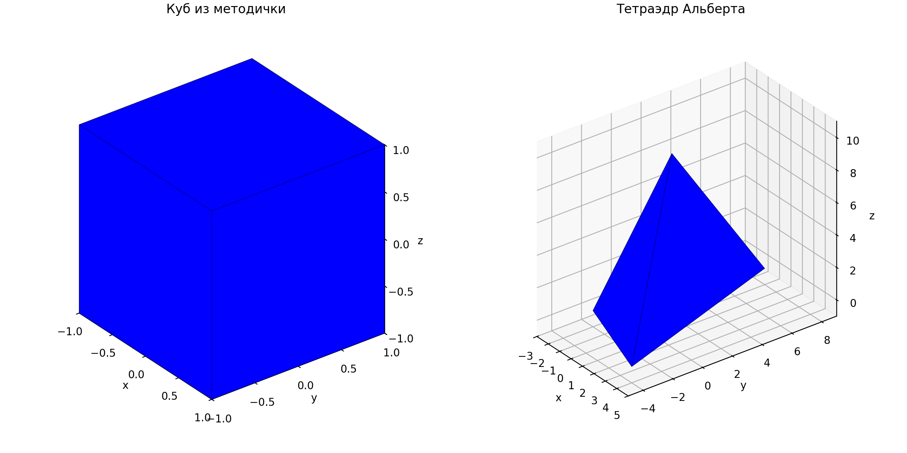
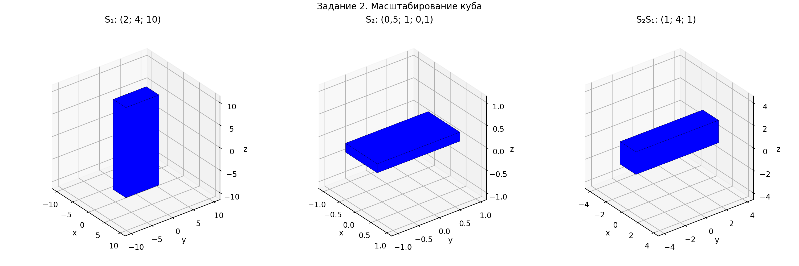
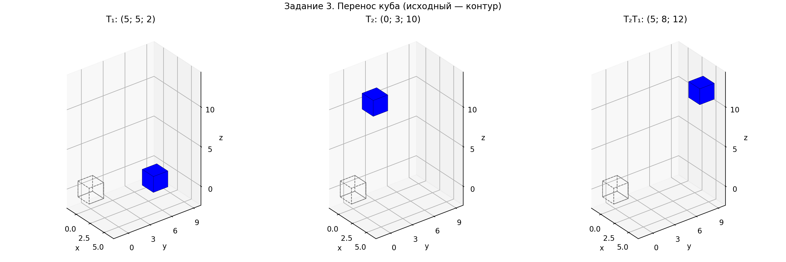
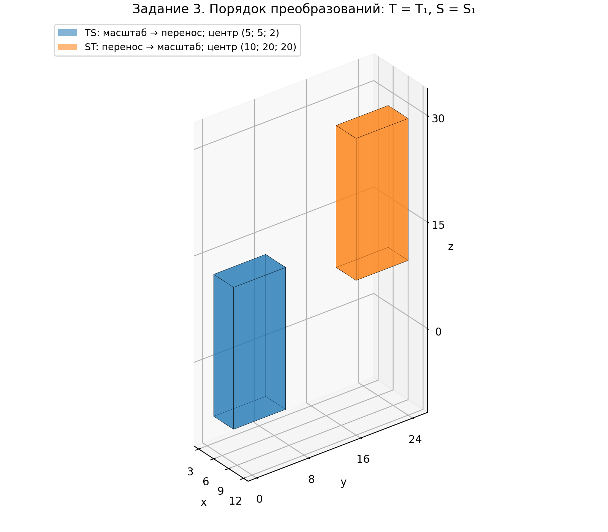

# ЛР3 — блок A — Альберт Осипов (черновик)

Задания 1–3. Исходные данные выбраны Альбертом и зафиксированы в `draft.md`.
Ниже собраны обсуждённые пояснения и проверенные расчёты из `code/block_a.py`.
Выводы оформлены по ответам Альберта с уточнением геометрического смысла определителя.

## Задание 1. Отрисовка куба и другой фигуры

### Однородные координаты и устройство кода

Каждая вершина хранится в столбце матрицы `vertices` как
$\widetilde p=(x,y,z,w)^T$. Для выбранных исходных фигур $w=1$.
Переход к декартовым координатам при $w\ne0$ имеет вид

$$
p=\begin{pmatrix}x/w\\y/w\\z/w\end{pmatrix}.
$$

Например, $(4,6,2,2)^T$ задаёт точку $(2,3,1)^T$.
Строка программы

```python
points = (vertices[:3, :] / vertices[3, :]).T
```

выполняет это деление для всех вершин. Транспонирование `.T` переводит
матрицу размера $3\times N$ в $N\times3$: отрисовщику нужны вершины по строкам.
Каждая строка `faces` задаёт индексы вершин одной грани в порядке обхода.
Индексация начинается с нуля. `points[faces]` собирает координаты граней,
а `Poly3DCollection` отображает их в пространстве.
Использована ортографическая проекция `proj_type="ortho"`.

### Исходный куб

Матрицы из Python-листинга методички:

$$
V=\begin{pmatrix}
-1&1&1&-1&-1&1&1&-1\\
-1&-1&1&1&-1&-1&1&1\\
-1&-1&-1&-1&1&1&1&1\\
1&1&1&1&1&1&1&1
\end{pmatrix},
$$

$$
F=\begin{pmatrix}
0&1&5&4\\
1&2&6&5\\
2&3&7&6\\
3&0&4&7\\
0&1&2&3\\
4&5&6&7
\end{pmatrix}.
$$

У грани $[0,1,2,3]$ все вершины имеют $z=-1$: это нижняя грань куба.
Центр куба находится в начале координат, длина ребра равна $2$.

### Тетраэдр

Вместо куба заданы вершины
$A=(-2,-2,0)$, $B=(4,-4,0)$, $C=(0,8,0)$, $D=(1,1,10)$:

$$
V_{\mathrm{tetra}}=\begin{pmatrix}
-2&4&0&1\\
-2&-4&8&1\\
0&0&0&10\\
1&1&1&1
\end{pmatrix},\qquad
F_{\mathrm{tetra}}=\begin{pmatrix}
0&2&1\\
0&1&3\\
1&2&3\\
2&0&3
\end{pmatrix}.
$$

Первые три вершины лежат в плоскости $z=0$, четвёртая — вне этой плоскости.
Вместо шести четырёхугольных граней получены четыре треугольные.
Пределы осей расширены под выбранные координаты; пропорции области построения
согласованы с диапазонами осей, чтобы единичный масштаб по всем осям совпадал.
Куб и тетраэдр показаны на рисунке 1.



### Вывод по заданию 1

Матрица $3\times3$ не может перенести начало
координат в другую точку, поскольку произведение любой матрицы на нулевой
вектор равно нулевому вектору. Четвёртая координата позволяет описать перенос
матричным умножением; перед отрисовкой однородные координаты переводятся
в декартовы делением на $w$.

## Задание 2. Масштабирование куба

### Общая структура матрицы

Масштабирование по координатным осям задаётся матрицей

$$
S(s_x,s_y,s_z)=\begin{pmatrix}
s_x&0&0&0\\
0&s_y&0&0\\
0&0&s_z&0\\
0&0&0&1
\end{pmatrix},\qquad
S\begin{pmatrix}x\\y\\z\\1\end{pmatrix}
=\begin{pmatrix}s_xx\\s_yy\\s_zz\\1\end{pmatrix}.
$$

Матрицы масштаба отдельно по $x$, $y$, $z$ получаются подстановкой
$(s_x,1,1)$, $(1,s_y,1)$, $(1,1,s_z)$ соответственно.
Все вершины преобразуются одновременно: $V'=SV$, в Python — `S @ vertices_cube`.

### Выбранные матрицы и их композиция

$$
S_1=\begin{pmatrix}
2&0&0&0\\
0&4&0&0\\
0&0&10&0\\
0&0&0&1
\end{pmatrix},\qquad
S_2=\begin{pmatrix}
0.5&0&0&0\\
0&1&0&0\\
0&0&0.1&0\\
0&0&0&1
\end{pmatrix}.
$$

Сначала применяется $S_1$, затем $S_2$. Для векторов-столбцов последняя
применяемая матрица стоит слева:

$$
S_2(S_1V)=(S_2S_1)V,\qquad
S_2S_1=\operatorname{diag}(0.5\cdot2,\;1\cdot4,\;0.1\cdot10,\;1)
=\begin{pmatrix}
1&0&0&0\\
0&4&0&0\\
0&0&1&0\\
0&0&0&1
\end{pmatrix}.
$$

Отдельные матрицы $S_1$ и $S_2$ применяются к исходному кубу, а третий
результат соответствует их последовательному применению.

| Преобразование | Размер по $x$ | Размер по $y$ | Размер по $z$ |
|---|---:|---:|---:|
| Исходный куб | 2 | 2 | 2 |
| $S_1$ | 4 | 8 | 20 |
| $S_2$ | 1 | 2 | 0.2 |
| $S_2S_1$ | 2 | 8 | 2 |

Например, для вершины $p=(-1,-1,-1,1)^T$:

$$
S_1p=(-2,-4,-10,1)^T,\quad
S_2p=(-0.5,-1,-0.1,1)^T,\quad
S_2S_1p=(-1,-4,-1,1)^T.
$$

Результаты приведены на рисунке 2. У панелей разные пределы осей,
поэтому абсолютные размеры нужно сравнивать по численным отметкам и таблице.
Внутри каждой панели единичный масштаб одинаков по трём осям.



### Вывод по заданию 2

При последовательном масштабировании коэффициенты по каждой оси перемножаются.
По оси $x$ получаем $2\cdot0.5=1$, а по оси $z$ — $10\cdot0.1=1$:
второе преобразование компенсирует первое, поэтому размеры по этим осям
возвращаются к исходным. По оси $y$ произведение равно $4\cdot1=4$,
поэтому растяжение в четыре раза сохраняется. Результат композиции —
прямоугольный параллелепипед с размерами $(2,8,2)$.

## Задание 3. Перенос и порядок преобразований

### Общая структура матрицы переноса

$$
T(a,b,c)=\begin{pmatrix}
1&0&0&a\\
0&1&0&b\\
0&0&1&c\\
0&0&0&1
\end{pmatrix},\qquad
T\begin{pmatrix}x\\y\\z\\1\end{pmatrix}
=\begin{pmatrix}x+a\\y+b\\z+c\\1\end{pmatrix}.
$$

Переносы отдельно по $x$, $y$, $z$ задаются $T(a,0,0)$, $T(0,b,0)$,
$T(0,0,c)$ соответственно. Последний столбец добавляет смещение к координатам.

### Выбранные переносы и композиция

$$
T_1=\begin{pmatrix}
1&0&0&5\\
0&1&0&5\\
0&0&1&2\\
0&0&0&1
\end{pmatrix},\qquad
T_2=\begin{pmatrix}
1&0&0&0\\
0&1&0&3\\
0&0&1&10\\
0&0&0&1
\end{pmatrix}.
$$

При последовательном применении векторы переноса складываются:

$$
T_2T_1=T(5+0,\;5+3,\;2+10)
=\begin{pmatrix}
1&0&0&5\\
0&1&0&8\\
0&0&1&12\\
0&0&0&1
\end{pmatrix}.
$$

Центры образов куба равны $(5,5,2)$, $(0,3,10)$ и $(5,8,12)$ соответственно.
Для исходной вершины $p=(-1,-1,-1,1)^T$:

$$
T_1p=(4,4,1,1)^T,\quad
T_2p=(-1,2,9,1)^T,\quad
T_2T_1p=(4,7,11,1)^T.
$$

Во всех трёх случаях размеры равны $(2,2,2)$. Результаты показаны на рисунке 3.
Серым пунктиром обозначен исходный куб; у трёх панелей одинаковые пределы осей.



### Сравнение TS и ST

Для сравнения выбраны $T=T_1$ и $S=S_1$:

$$
TS=\begin{pmatrix}
2&0&0&5\\
0&4&0&5\\
0&0&10&2\\
0&0&0&1
\end{pmatrix},\qquad
ST=\begin{pmatrix}
2&0&0&10\\
0&4&0&20\\
0&0&10&20\\
0&0&0&1
\end{pmatrix}.
$$

При $TS$ точка сначала масштабируется, затем переносится:

$$
(x,y,z)\longmapsto(2x+5,\;4y+5,\;10z+2).
$$

При $ST$ точка сначала переносится, затем масштабируется:

$$
(x,y,z)\longmapsto(2(x+5),\;4(y+5),\;10(z+2))
=(2x+10,\;4y+20,\;10z+20).
$$

Например, $TSp=(3,1,-8,1)^T$, а $STp=(8,16,10,1)^T$.
Разность декартовых координат равна $(5,15,18)$ для каждой вершины.

| Преобразование | Центр образа | Размеры по $x,y,z$ |
|---|---|---|
| $TS$ | $(5,5,2)$ | $(4,8,20)$ |
| $ST$ | $(10,20,20)$ | $(4,8,20)$ |

Результаты неэквивалентны: матрицы отличаются последним столбцом и дают
разные координаты образов. Сравнение приведено на рисунке 4.



### Вывод по заданию 3

Перенос добавляет один и тот же вектор ко всем вершинам, поэтому разности
их координат и размеры куба не меняются. Два последовательных переноса
равносильны одному переносу на сумму векторов: $(5,8,12)$.

В общем случае умножение матриц некоммутативно: порядок преобразований
может менять результат. Для выбранных матриц $TS\ne ST$. В $TS$ масштаб
применяется до переноса, а в $ST$ масштабируется и добавленное смещение:
$(5,5,2)$ превращается в $(2\cdot5,4\cdot5,10\cdot2)=(10,20,20)$.
Поэтому положения образов различаются. Размеры в обоих случаях одинаковы,
$(4,8,20)$, поскольку применяется один и тот же масштаб, а перенос размеры
не меняет.

Определители произведений совпадают:

$$
\det(TS)=\det(T)\det(S)=\det(S)\det(T)=\det(ST)=1\cdot80=80.
$$

Это следует из коммутативности умножения чисел и означает одинаковое
изменение объёма — в $80$ раз. Само по себе равенство определителей
не гарантирует одинаковых размеров или положения фигур.
